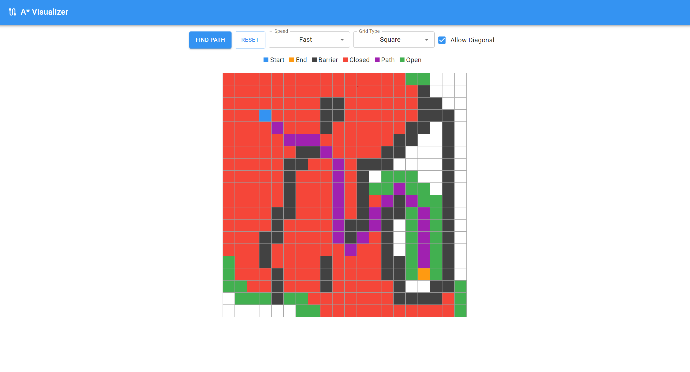
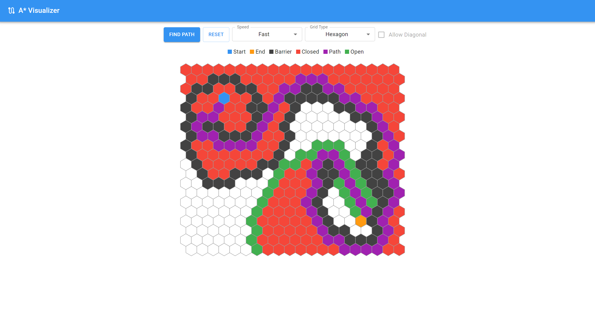

# A* Pathfinding Visualizer

An A* pathfinding visualizer implemented with React, TypeScript, Vite and d3.

## Demo

[https://astar-pathfinding-react-ts.netlify.app/](https://astar-pathfinding-react-ts.netlify.app/)

## Screenshots

### A* Pathfinding with Square Grid


### A* Pathfinding with Hexagon Grid


## Tech stack

| Area | Library |
| --- | --- |
| UI | React 19, MUI 9, Emotion, styled-components 6 |
| Build | Vite 8 |
| Language | TypeScript 5.9 |
| Graphs | d3, d3-hexbin |
| Algorithms | `@datastructures-js/priority-queue`, lodash |
| Tests | Vitest 5, Testing Library, jsdom |
| Lint | ESLint 10 (flat config), typescript-eslint |
| Package manager | pnpm 12 |

## Requirements

- Node.js **>= 22.12** — see `.nvmrc`
- pnpm **12** — see the `packageManager` field in `package.json`

```sh
corepack enable   # or: npm install -g pnpm
pnpm install
```

## Running the app

```sh
pnpm dev        # http://localhost:3000
pnpm build      # production build -> dist/
pnpm preview    # serve the production build locally
```

## Quality checks

```sh
pnpm typecheck  # tsc --noEmit
pnpm lint       # ESLint flat config
pnpm test       # Vitest watch mode
pnpm test:ci    # Vitest single run
```

## Project structure

```text
src/
  algorithms/        A* implementation (priority queue, heuristics, path rebuild)
  apps/MainApp/      Main visualizer: grid, controls, drag handling
  apps/MVPApp/       Earlier prototype (not mounted, still typechecked)
  components/        Navbar, Legends
  data/              Grid settings and hex/square geometry
  helpers/           Grid generation and neighbor lookup
  interfaces/        Shared types
  theme/             Cell colors
```

## Deployment

Netlify configuration lives in `netlify.toml`:

- Build command: `pnpm build`
- Publish directory: `dist`
- Node version: taken from `.nvmrc`

CI runs typecheck, lint, tests, audit and build on pushes to `main` and on pull requests (`.github/workflows/ci.yml`).

## Notes

- The project was migrated from Create React App to Vite; the phased migration log is in [`MIGRATION_PLAN.md`](./MIGRATION_PLAN.md).
- TypeScript is pinned to 5.9 because `typescript-eslint` does not support TypeScript 7 yet. The upgrade is a one-line change once support lands.

## Reference

### A* algorithm
- [A* pathfinding python tutorial](https://www.youtube.com/watch?v=JtiK0DOeI4A)
- [A* pathfinding algorithm explanation](https://www.youtube.com/watch?v=-L-WgKMFuhE)
- [Understanding A* (with hexagon tiles)](https://www.youtube.com/watch?v=i0x5fj4PqP4)
- [Heuristics (Including Diagonal)](https://theory.stanford.edu/~amitp/GameProgramming/Heuristics.html)
- [Hexagon Heuristics](https://blog.theknightsofunity.com/pathfinding-on-a-hexagonal-grid-a-algorithm/)
- [A* pathfinding from Red Blob Games](https://theory.stanford.edu/~amitp/GameProgramming/)

### Drawing Hexagons in d3
- [Hexagon grid heatmap](https://observablehq.com/@nbremer/hexagon-grid-heatmap)
